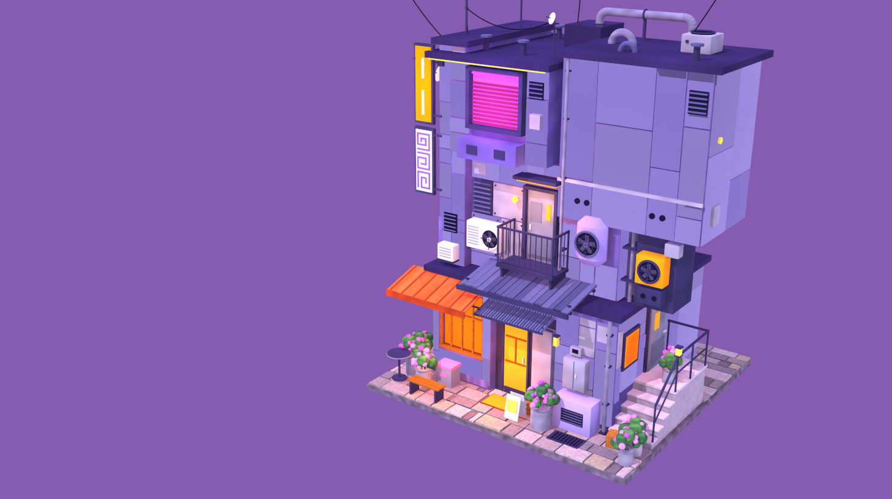

<div align="center">

# C3D MCP

### Talk to Cheetah3D. Describe a scene in plain words, and an AI assistant builds, lights and renders it for you.

[](https://github.com/megatih/c3d-mcp/releases/latest)
[](LICENSE)
[](#-what-you-need)
[](https://www.cheetah3d.com)

**[Download](https://github.com/megatih/c3d-mcp/releases/latest)** · **[Get started](#-get-started-in-5-steps)** · **[Your first scene](#-your-first-scene)** · **[FAQ](#-questions-and-answers)** · **[Introduction article](https://megatih.github.io/2026-10-29-cheetah3d-meets-ai-introducing-c3d-mcp/)**

<table>
  <tr>
    <td></td>
    <td></td>
  </tr>
  <tr>
    <td align="center"><sub>Cornell box: modelled, lit and rendered by an AI assistant</sub></td>
    <td align="center"><sub>Cyberpunk diorama: built from a written description</sub></td>
  </tr>
</table>

</div>

---

## 👋 What is this?

**C3D MCP** is a free Mac app that lets an AI assistant work inside **Cheetah3D** for you.

You type what you want, for example *"a wooden dining table with four chairs, warm evening light, render it"*, and the assistant does the clicking: it creates the objects, adds materials and lights, sets up the camera and renders the picture. You watch it happen in Cheetah3D, and you can take over at any time. Everything it makes is an ordinary Cheetah3D scene that you can keep editing by hand.

You don't need to know how to program, and you don't need the Terminal.

<details>
<summary><b>New to AI tools? A few words explained</b></summary>

| Word | What it means here |
|---|---|
| **AI assistant** | A chat app you type to, such as **Claude Desktop**. C3D MCP connects it to Cheetah3D. |
| **MCP** | Short for *Model Context Protocol*. Think of it as a plug: it lets an AI assistant use another app on your Mac. C3D MCP is the plug for Cheetah3D. |
| **Bridge** | A small helper script that C3D MCP puts inside Cheetah3D, so the assistant's requests can reach it. The app installs it with one click. |
| **GitHub** | The website you're on. It hosts this project's files. You only need it to download the app; you don't need an account. |
| **Release** | A finished version of the app, ready to download, listed on the [Releases page](https://github.com/megatih/c3d-mcp/releases/latest). |

</details>

## ✨ What you can ask for

Just type in everyday language. Some ideas:

- 🪑 **Model things:** *"Build a coffee mug with a handle"*, *"Make a low-poly tree"*, *"Add a staircase with 12 steps"*
- 🎨 **Materials and textures:** *"Give the table a dark walnut wood look"*, *"Make the lamp shade glow orange"*
- 💡 **Lighting and camera:** *"Set up three-point lighting"*, *"Frame the camera on the chair from a low angle"*
- 🎬 **Animation:** *"Make a 5-second turntable of the model"*, *"Animate the ball bouncing twice"*
- 🖼️ **Rendering:** *"Render a 1920×1080 image"*, *"Render the animation as an image sequence"*
- 📦 **Import and export:** *"Find a free armchair model and add it"* (from [Poly Haven](https://polyhaven.com), free to use), *"Export the scene as USDZ"*
- 🔍 **Ask about your scene:** *"What's in this scene?"*, *"Which objects have no material?"*

The assistant looks at its own renders and fixes what doesn't look right, so you can ask for changes the way you'd ask a colleague: *"make it a bit warmer"*, *"move the lamp to the left"*.

## ✅ What you need

- [x] A Mac with **Apple Silicon** (M1 or newer) running **macOS 14 Sonoma or newer**
- [x] **[Cheetah3D 8.1.3](https://www.cheetah3d.com)**, installed and opened at least once
- [x] An **AI assistant app**. If you've never used one, start with **[Claude Desktop](https://claude.ai/download)**. C3D MCP also works with Claude Code, Codex, Gemini CLI, Antigravity, Cursor and LM Studio.

That's it. No coding tools, no extra downloads: the app brings everything else it needs.

## 🚀 Get started in 5 steps

**1. Download the app.**
Go to the **[latest release](https://github.com/megatih/c3d-mcp/releases/latest)**, scroll down to **Assets**, and click the file named **`C3D-MCP-<version>.dmg`** (for example `C3D-MCP-0.4.2.dmg`). Open the downloaded file and drag **C3D MCP** onto **Applications**.

**2. Open it (one extra click the first time).**
The first time you open C3D MCP, macOS says it *cannot verify* the app. That's expected: this free project isn't registered with Apple's paid developer program, so macOS asks you to confirm once.
Click **Done**, open **System Settings › Privacy & Security**, scroll down to the message about *C3D MCP*, click **Open Anyway** and enter your Mac password. Then open the app again and click **Open**. You only do this once.

<details>
<summary>Comfortable with the Terminal? Skip the prompt with one line</summary>

This downloads the same app, checks it hasn't been tampered with (SHA-256), copies it to Applications and opens it. Files downloaded this way aren't flagged by macOS, so there's no prompt:

```bash
curl -fsSL https://github.com/megatih/c3d-mcp/releases/latest/download/get-c3d-mcp.sh | bash
```

</details>

**3. Connect it to Cheetah3D.**
In the C3D MCP window, click **Bridge › Install or update**. Then **quit and reopen Cheetah3D** once, so it picks up the bridge.

**4. Connect your AI assistant.**
Click **AI clients**, tick the app you use (for example **Claude Desktop**), then quit and reopen that app.

**5. Give permission.**
Click **Permissions** and allow **Accessibility** for *C3D MCP*. This lets it press Cheetah3D's menu for the assistant. (Screen Recording is optional; it lets the assistant take screenshots of the Cheetah3D viewport.)

**Done!** The **Overview** page shows a **Setup** checklist. When all four items are green, you're ready.

> 💡 Already used an older version that you installed another way? Open **Cleanup** in the app: it finds and removes the old copy for you (files go to the Trash). Full step-by-step guide: [docs/INSTALL.md](docs/INSTALL.md).

## 🎨 Your first scene

1. Open **Cheetah3D** and your **AI assistant**.
2. Type:

   > *Build a dining table with four legs and a wood material, light it nicely, and render it.*

3. Watch Cheetah3D: objects appear, materials are applied, and after a moment the assistant shows you the render and describes what it did.

**Good to know while it works:**

- **Don't click in Cheetah3D while the assistant is working.** It's pressing Cheetah3D's menus for you, and a click or an open dialog box can get in the way. If something seems stuck, close any open dialog in Cheetah3D.
- **Your AI app may ask "Allow this tool?"** the first time. Choose **Always allow** to stop the repeated questions. (In the C3D MCP app, **Permissions** lets you choose how often it asks.)
- **C3D MCP may ask you to confirm** before bigger actions, such as deleting many objects or saving over a file. Read the question and answer yes or no.
- **Big renders can take a few minutes.** The assistant waits for them.

## 🛡️ Your work is safe

- It **never overwrites a file that existed before** you started the session.
- It **saves a checkpoint** before anything destructive, so the assistant can roll back a mistake.
- It **asks first** before deleting many objects, overwriting files or running scripts that touch your files.
- It **backs up** your Cheetah3D Scripts folder before changing it, and uninstalling never touches your own scripts.

One thing to remember: Cheetah3D's own **Edit › Undo** can't undo changes made by the assistant's scripts. Ask the assistant to *"restore the last checkpoint"* instead.

## 🔄 Updating and uninstalling

- **Updates** arrive inside the app (**Overview › Updates**). Your permissions normally carry over, so you don't have to set things up again.
- **To uninstall:** in the app, click **Bridge › Uninstall everything**, then drag **C3D MCP** to the Trash. Your scenes, scripts and backups stay where they are.

## ❓ Questions and answers

<details>
<summary><b>Is it free?</b></summary>

C3D MCP is free and open source (MIT license). Cheetah3D is a paid app you buy from its maker. Your AI assistant may need an account or a subscription, depending on which one you use; LM Studio can run AI models locally on your Mac for free.
</details>

<details>
<summary><b>Does it need the internet?</b></summary>

C3D MCP itself works on your Mac. Most AI assistants (like Claude Desktop) run in the cloud and need a connection. Downloading free models from Poly Haven also needs the internet.
</details>

<details>
<summary><b>Which AI assistants work?</b></summary>

Claude Desktop, Claude Code, Codex, Gemini CLI, Antigravity and Cursor can be connected with one tick in the app. LM Studio works too (set up by hand, see [docs/SETUP.md](docs/SETUP.md)). Bigger, more capable models give noticeably better results than small local ones.
</details>

<details>
<summary><b>Why does macOS warn me the first time?</b></summary>

The app is signed with the project's own certificate rather than through Apple's paid developer program. macOS asks you to confirm once (step 2 above); after that, updates open normally.
</details>

<details>
<summary><b>The assistant says Cheetah3D isn't responding, or nothing happens.</b></summary>

- Check that no dialog box is open in Cheetah3D and close it if there is one.
- Open C3D MCP and look at **Overview**: anything red tells you what to fix.
- Did you restart Cheetah3D after installing the bridge? It only notices the bridge at launch.
- Is your AI app listed as connected under **AI clients**? Restart the AI app after connecting it.

More fixes: [docs/TROUBLESHOOTING.md](docs/TROUBLESHOOTING.md).
</details>

<details>
<summary><b>Does it work on Intel Macs or other Cheetah3D versions?</b></summary>

It's built and tested for Apple Silicon Macs and Cheetah3D 8.1.3. Other combinations are not supported.
</details>

<details>
<summary><b>Will it learn Cheetah3D better over time?</b></summary>

The app ships with **agent skills**: ready-made know-how about Cheetah3D modelling, materials, lighting, animation and scripting that makes assistants noticeably better. **Bridge › Install agent skills** adds them for Claude Code, Codex and Antigravity; for Claude Desktop and ChatGPT you can upload the skill files from the release page ([how](docs/SKILLS.md)).
</details>

## ⚠️ Known limitations

- Cheetah3D 8.1.3 can't open **glTF/GLB** files (FBX, OBJ, DAE, STL, 3DS, USDZ and DXF work).
- Exporting to **OBJ** crashed Cheetah3D once on a complex scene; prefer FBX or USDZ (a checkpoint is saved first anyway).
- Renders are saved as **PNG, JPG or TIFF**.
- An open **dialog box** in Cheetah3D pauses everything until you close it.

The full, honest list: [docs/limitations.md](docs/limitations.md).

---

## 🛠️ For advanced users and developers

Everything below is optional reading.

<details>
<summary><b>How it works</b></summary>

Cheetah3D has no network API, no AppleScript dictionary and no URL scheme. `c3d-mcp` therefore works through three parts, all delivered by one app:

```
 MCP client ──stdio──▶ c3d-mcp server (TypeScript) ──mailbox files──▶ bridge macro inside Cheetah3D (JavaScript)
                              │                                              ▲
                              └──Unix socket──▶ C3D MCP.app (Swift: control panel + helper) ─┘ presses the macro's menu item (Accessibility)
```

* **Server** (`packages/server`): 63 `c3d_*` tools (60 scene, render and asset tools plus 3 health tools), resources and prompts; queue, safety checks, backups.
* **Bridge** (`bridge/`): a tiny loader macro plus a runtime that Cheetah3D executes, draining a request inbox and writing results.
* **App** (`helper/`): `C3D MCP.app`, a control panel plus the Accessibility helper that activates Cheetah3D, presses the bridge menu item, reports dialogs and takes screenshots. It also carries its own Node.js and the server, so nothing else has to be installed.

Developed and tested on macOS 27.2.
</details>

<details>
<summary><b>All tools</b></summary>

| Area | Tools (all prefixed `c3d_`) |
|---|---|
| Health | `doctor`, `install_bridge`, `capabilities` |
| Documents | `get_document_info`, `new_document`, `open_document`, `use_document`, `save_document`, `export` (jas/obj/fbx/dae/stl/3ds/usdz/gltf/glb/dxf), `checkpoint`, `restore_checkpoint` |
| Scene | `list_scene`, `get_object`, `create_object`, `delete_objects`, `reparent`, `rename`, `duplicate`, `set_transform`, `get_parameters`, `set_parameters`, `select`, `look_at` |
| Geometry | `create_mesh` (n-gons, validated), `get_mesh`, `edit_mesh`, `create_spline`, `make_editable` |
| Materials | `list_materials`, `create_material`, `set_material_params`, `add_material_node`, `connect_nodes`, `get_material_graph`, `assign_material`, `set_texture` |
| Tags, camera, light | `add_tag`, `set_tag_params`, `remove_tag`, `set_camera`, `set_light` |
| Animation | `set_time`, `set_fps`, `takes`, `set_keyframes`, `get_keyframes` |
| Rendering | `set_render_settings`, `render_image` (returns a downscaled image + blank/luma stats), `render_sequence` + `job_status`/`job_cancel`, `capture_viewport` |
| Assets | `search_assets`, `import_asset` (Poly Haven, CC0, no key), `merge_file` |
| Scripting | `run_script` (sandboxed JS), `lint_script`, `get_console`, `search_api_docs` |

**Agent skills** for Claude Code, Codex CLI, Antigravity, Claude Desktop and ChatGPT ship with every release: the app installs them for the first three, and the zips on the release page upload to Claude Desktop and ChatGPT (see [docs/SKILLS.md](docs/SKILLS.md)).

Full reference with parameters: [docs/TOOLS.md](docs/TOOLS.md) (generated from the schemas).
</details>

<details>
<summary><b>Command line equivalents</b></summary>

Everything in the control panel also exists as a command of the bundled server (`"/Applications/C3D MCP.app/Contents/Resources/node/bin/node" "/Applications/C3D MCP.app/Contents/Resources/server/bin/c3d-mcp.js" <command>`, add `--json` for machine-readable output):

| I want to… | In the app | Command |
|---|---|---|
| see what is installed and whether it works | Overview, Bridge | `status`, `doctor` |
| install, update or repair the bridge | Bridge › Install or update / Repair | `install [--repair\|--reinstall] [--dry-run]` |
| connect or disconnect an AI client | AI clients | `clients list\|add\|remove <client>` |
| stop Claude Code asking before every tool call | Permissions › Allow all c3d tools | `permissions allow\|revoke` |
| choose how often c3d-mcp asks to confirm | Permissions › Confirmation prompts | `C3D_MCP_APPROVAL` (below) |
| remove leftovers of older installs | Cleanup | `legacy scan\|remove` |
| remove the bridge, skills and client entries | Bridge › Uninstall everything | `uninstall --all` |
| install the agent skills | Bridge › Install agent skills | `skills install\|uninstall` |

Updates are delivered with Sparkle, signed with the project's update key. Per-client configuration: [docs/SETUP.md](docs/SETUP.md). What the app puts where: [docs/INSTALL.md](docs/INSTALL.md#what-the-app-puts-where).
</details>

<details>
<summary><b>Profiles and switches</b></summary>

`C3D_MCP_PROFILE=full` (default) · `local` (≤ 25 tools, short descriptions, no script execution — for small local models) · `readonly` (read tools only).
`C3D_MCP_DISABLE_EXEC=1`, `C3D_MCP_DISABLE_ASSETS=1`, `C3D_MCP_DISABLE_SHELL=1`, `C3D_MCP_NO_AUTOLAUNCH=1` (by default the first call launches Cheetah3D when it is not running and C3D MCP is installed).
`C3D_MCP_APPROVAL=session` (default: a confirmation you accepted is not asked again for the same action until the server restarts) · `strict` (ask every time) · `trusted` (never ask; files that existed before the session are still never overwritten). The control panel stores the choice in `MCP/settings.json`; the environment variable wins.

All variables: [docs/SETUP.md](docs/SETUP.md#environment-variables).
</details>

<details>
<summary><b>Security model</b></summary>

Same-user threat model. The server never overwrites a file that existed before the session, takes automatic checkpoints before destructive operations, asks for confirmation (MCP elicitation, or `confirm:true`; see `C3D_MCP_APPROVAL` above) before deleting many objects, overwriting or running scripts that touch files/shell, and `c3d_run_script` runs with best-effort containment that is **not** a security boundary. Details: [docs/SECURITY.md](docs/SECURITY.md).
</details>

<details>
<summary><b>Things worth knowing about Cheetah3D itself</b></summary>

Verified against 8.1.3 while building this (details in `research/08-open-questions-and-probes.md`):
render formats are png/jpg/tiff only; glTF/GLB cannot be opened (FBX/OBJ/DAE/STL/3DS/USDZ/DXF can); object names are not unique (tools address objects by stable `id`); Edit › Undo does not revert script changes (use checkpoints); exporting **OBJ** crashed Cheetah3D once on a nested scene (an automatic checkpoint is taken first; prefer other formats); a dialog open in Cheetah3D blocks everything (`BLOCKED_BY_MODAL` carries its text); Cheetah3D's front face is clockwise, so `c3d_create_mesh` converts your counter-clockwise polygons to get outward normals; 30 material tags on one object crashed it, 24 were fine (the tools stop at 24).
</details>

<details>
<summary><b>Repository layout</b></summary>

`packages/server` TypeScript MCP server · `bridge/` in-app runtime + Swift JavaScriptCore test harness · `helper/` Swift package: `HelperCore` (the Accessibility helper), `AppCore` + `C3DMCPApp` (the control panel app), `c3d-helper-ctl` (diagnostics) · `contracts/` JSON Schemas shared by all three · `docs/PROTOCOL.md` the bridge protocol · `evals/` task suite + runner · `packaging/` signing, update-key, appcast, DMG and the curl installer · `scripts/` build, release and leak-check scripts · `skills/` agent skills · `research/` the research notes and live probe results (`research/10` = what was verified in 8.1.3) · `vendor/c3d-scripting-kb` pinned MIT snapshot and `vendor/learn3d-cheetah` pinned BSD-2 book text, both used for doc search, lint rules and skills.
</details>

<details>
<summary><b>Development</b></summary>

```bash
cd packages/server && npm ci && npm run lint && npm run typecheck && npm test      # unit/contract tests (offline)
scripts/test-bridge.sh                                                              # in-app runtime tests on a Swift JavaScriptCore harness with strict mocks
cd helper && swift test                                                             # helper and app-model tests (fake Accessibility provider)
C3D_LIVE=1 npm run test:live                                                        # needs Cheetah3D running + installed bridge (uses scratch documents)
node evals/runner/run.mjs --n=3                                                     # agent evals through `claude -p` (spends API credit; budget cap built in)
packaging/make-signing-identity.sh && packaging/make-update-key.sh                  # once: the self-signed signing identity and the update key (see the scripts' headers)
scripts/build-app.sh                                                                # builds, signs and packs release/app/ (dmg, zip, appcast.xml, get-c3d-mcp.sh)
scripts/release.sh                                                                  # skills zips + the app + leak scan + checksums into release/ (publishes nothing)
```

The live suite, the `packages/server/scripts/*.mjs` dev scripts and the evals close the Cheetah3D windows they open (answering "Don't Save"), through `packages/server/scripts/window-cleanup.mjs`. Windows that were already open stay, but do not create documents by hand while a run is in progress: they would be closed too. Set `C3D_KEEP_WINDOWS=1` to keep a run's windows for inspection.

Changes per version: [CHANGELOG.md](CHANGELOG.md).
</details>

---

## 🙏 Credits and knowledge sources

### Cheetah3D, by Martin Wengenmayer

c3d-mcp exists because of **[Cheetah3D](https://www.cheetah3d.com)**, created by **Martin Wengenmayer** (MW3D-Solutions). The first versions of c3d-mcp were built and verified against his work:

* **The Cheetah3D app**, the program everything here automates.
* **The official Cheetah3D manual and its JavaScript scripting reference**, shipped inside the app, which describe the classes and methods the bridge and the tools use.
* **The official example scripts** that come with Cheetah3D.

The official reference and example scripts are © Martin Wengenmayer / MW3D-Solutions. Thank you for an app worth building on.

### Community knowledge, by Tonio Loewald

After the first versions were working, I discovered two excellent community resources by **Tonio Loewald**, who documented Cheetah3D scripting for everyone. They now strengthen the tools and skills:

* **[c3d-scripting-kb](https://github.com/tonioloewald/c3d-scripting-kb)** (MIT): the Cheetah3D API reference as Markdown, the gotchas and patterns collected from the user forum, the official example scripts, the linter whose rules `c3d_lint_script` ports, and the forum archive. We use it for `c3d_search_api_docs`, lint rules, MCP resources and skill content.
* **[Learn 3D with Cheetah 3D](https://learn3d.loewald.com)** (BSD-2-Clause, [source](https://github.com/tonioloewald/Learn-3D-with-Cheetah-3D)): the book's scripting chapter and its guidance on lights, materials, rendering and animation. We use it for the search corpus and for skill recipes.

The forum scripts and threads belong to their authors (credited in the KB's `NOTICE.md`; email addresses and other people's home folders were removed from our copy).

Everything taken from these sources was checked against Cheetah3D 8.1.3 first; what held, what changed and what could not be tested is recorded in [research/10-kb-verification-8.1.3.md](research/10-kb-verification-8.1.3.md) and surfaced to agents as trust levels and notes in search results. Corrections to those sources are ours, not theirs.

## 📄 License

MIT. The vendored knowledge base (`vendor/c3d-scripting-kb`) is MIT © its authors (forum material per its `NOTICE.md`); the vendored book text (`vendor/learn3d-cheetah`) is BSD-2-Clause © 2019 Tonio Loewald; see their `LICENSE` files.

<div align="center">
<sub>Made for the Cheetah3D community · Not affiliated with or endorsed by MW3D-Solutions</sub>
</div>
